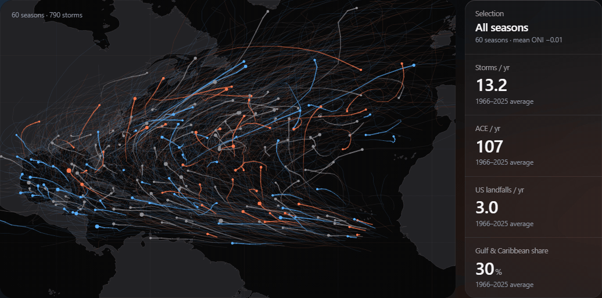
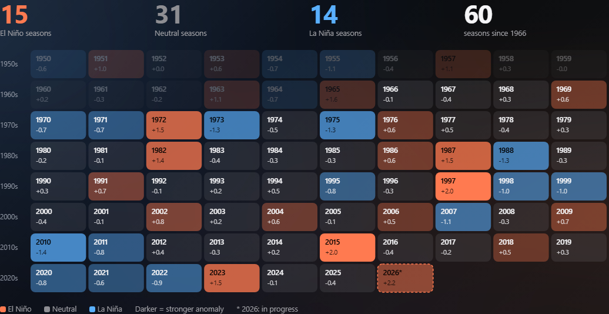
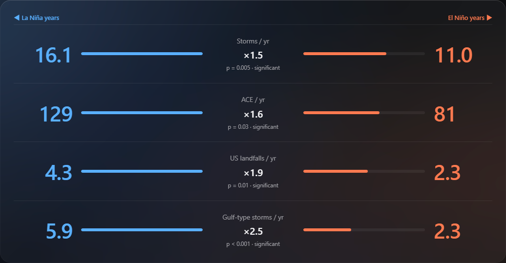
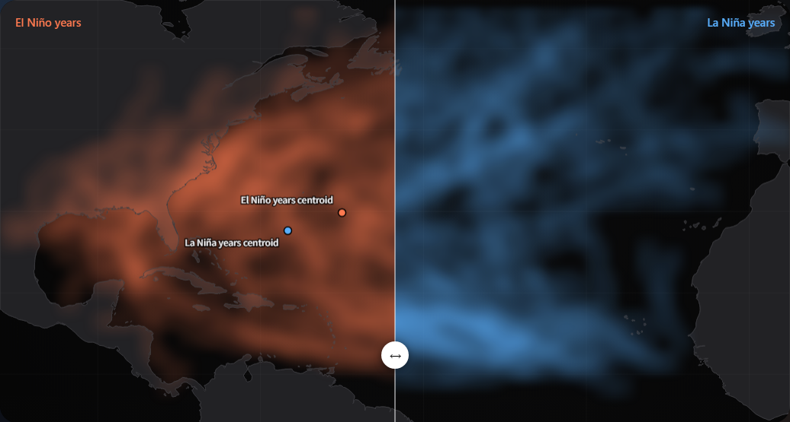
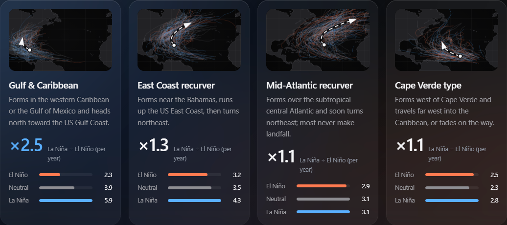
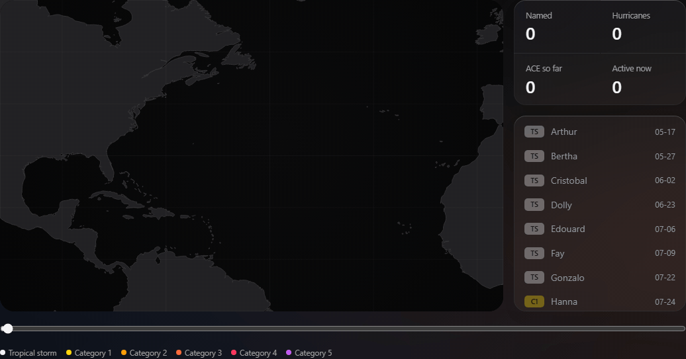
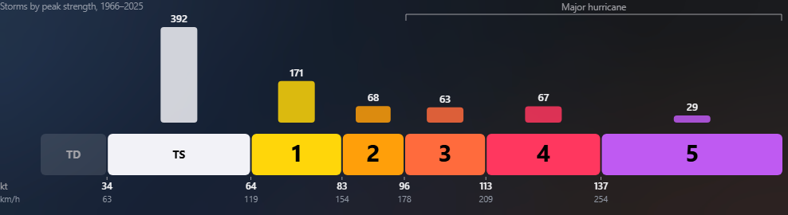
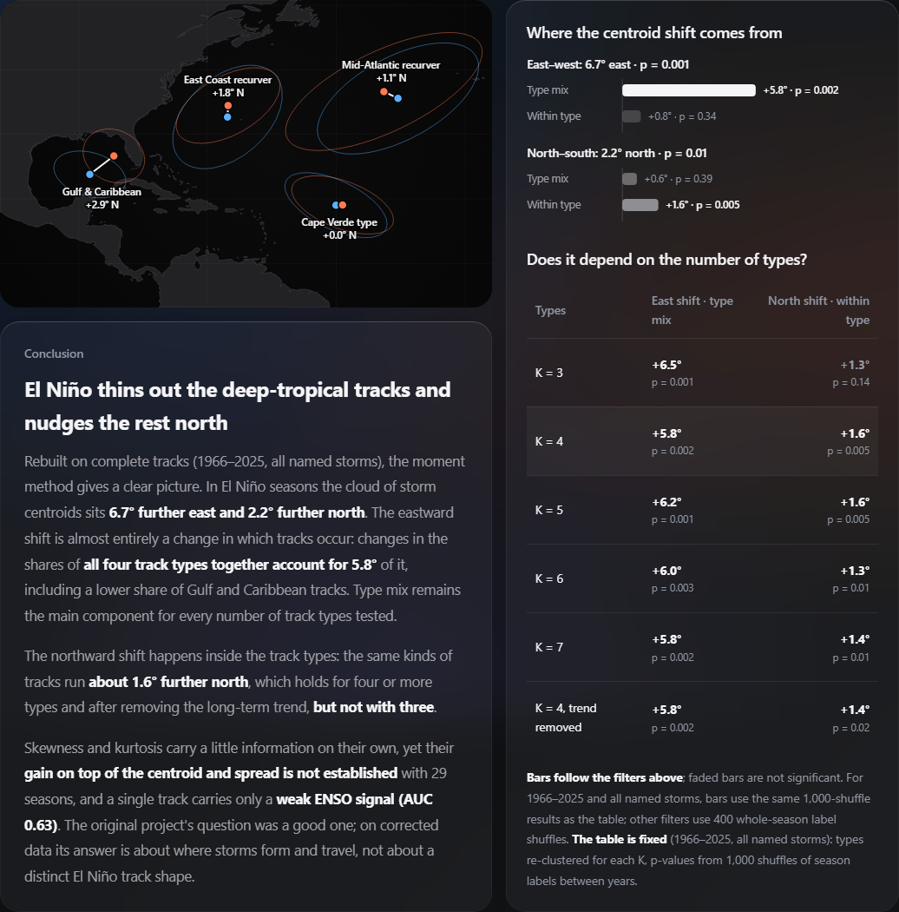

<div align="center">

<picture>
  <source media="(prefers-color-scheme: dark)" srcset="assets/readme/hero-dark.gif">
  <source media="(prefers-color-scheme: light)" srcset="assets/readme/hero-light.gif">
  
</picture>

# ENSO Storm Atlas

**The Pacific warms. The Atlantic quiets.**<br>
979 North Atlantic storms (1950–2025) and what El Niño and La Niña do to them.

[**Open the atlas →**](https://bokaihe.github.io/ENSO-Storm-Atlas/) &nbsp;·&nbsp; English / 中文 &nbsp;·&nbsp; dark / light

<br>

| Named storms / yr | Energy (ACE) / yr | US landfalls / yr | Track centroid |
|:---:|:---:|:---:|:---:|
| **16.1** La Niña<br>**11.0** El Niño | **129** vs **81** | **4.3** vs **2.3** | El Niño: **6.7° east**, **2.2° north** |

<sub>1966–2025 · pairs: La Niña vs El Niño; centroid: El Niño minus La Niña · whole-season permutation tests: all listed contrasts p < 0.05</sub>

</div>

---

### Every season at a glance


### La Niña vs El Niño


<table>
<tr>
<td width="50%"><b>Where the storms go</b><br></td>
<td width="50%"><b>Which storms El Niño takes away</b><br></td>
</tr>
</table>

### Any season, fast-forwarded



### What actually moves


> **El Niño thins out the deep-tropical tracks and nudges the rest north.**
> The eastward shift mainly reflects a change in *which* tracks occur. The northward shift mainly reflects changes *within* track types.

---

## Run it

```bash
pip install -r requirements.txt
python scripts/download_data.py      # IBTrACS + ONI + coastlines
python scripts/build_data.py
python scripts/analyze.py            # ~10 min
python scripts/decompose.py          # ~2 min
python scripts/build_site.py         # -> docs/index.html
```

Or just open `docs/index.html`. The page embeds its data in a single HTML file; an internet connection is needed for D3 and web fonts.

<details>
<summary><b>Project layout</b></summary>

```
scripts/
  download_data.py   fetch IBTrACS, ONI and coastline files into data/raw/
  build_data.py      clean tracks, ENSO phase, ACE / landfall / recurvature, track clusters -> build/data.json
  analyze.py         permutation tests, moments, classification AUC -> build/ml_results.json
  decompose.py       type mix vs within-type split of the centroid shift, K = 3..7 -> build/decomp.json
  build_site.py      embed everything into site/template.html -> docs/index.html
  readme_media.mjs   render the GIFs and screenshots in assets/readme (Node ≥ 22, Chrome, ffmpeg)
site/template.html   page source: HTML, CSS, JS, English + 中文
docs/index.html      the built site (GitHub Pages serves this folder)
assets/readme/       README media
```

To publish: **Settings → Pages → Deploy from a branch → `main` / `docs`**.
</details>

<details>
<summary><b>Data & methods</b></summary>

- **Tracks:** IBTrACS v04r01 North Atlantic. The analysis uses `main` tracks at 00/06/12/18 UTC fixes, with `USA_WIND` (1-min sustained, kt). It includes every storm with at least one tropical or subtropical fix ≥ 34 kt: 979 storms, 1950–2025.
- **ENSO phase:** NOAA CPC ONI for the August–October season. El Niño is ONI ≥ +0.5 and La Niña is ONI ≤ −0.5. The analysis uses one definition throughout.
- **Significance:** permutation tests that shuffle labels between whole seasons, so storms from the same year are never treated as independent samples.
- **Track types:** each track is resampled to 16 points and clustered with a single K-Means model. K = 4 has the best silhouette score for K = 3–7.
- **Type mix vs within type:** the El Niño − La Niña centroid difference is split into two parts, each weighted by the average of the two phases. The 6.7° eastward shift is almost all type mix (5.8°, p = 0.002 at K = 4); type mix remains the dominant component for every K = 3–7. The 2.2° northward shift is mostly within type (1.6°, p = 0.005). That holds for K = 4–7 and after detrending, but not at K = 3.
- **Single-track classification:** logistic regression with balanced class weights, averaged over the same 10 random season-grouped 10-fold splits. Each feature set is compared with its own shuffled-season null. All nine moments reach AUC 0.63, against a null 5–95% range of 0.41–0.57. The signal is real but weak.
- **Skewness & kurtosis:** adding them to the 1st and 2nd moments raises AUC by 0.02. The season-bootstrap 95% interval for that gain is −0.045 to +0.083, so the gain is not established.
- **Limitations:** the samples are small. For 1966–2025 there are 14 La Niña and 15 El Niño seasons. Pre-1966 records miss some short-lived storms. AMO and long-term warming are not controlled. All results are correlations.
</details>

<details>
<summary><b>What was fixed from the original notebook</b></summary>

This project is a redesign and correction of [sarika-debruyn/hurricane-prediction-ml](https://github.com/sarika-debruyn/hurricane-prediction-ml). The original notebook had these problems:

- Its Saffir–Simpson categorisation counted tropical depressions as Category 1 and treated missing winds as Category 5.
- Its ENSO 5-month rule sorted months alphabetically, and it mixed three different ENSO definitions.
- Clustering dropped track points instead of whole storms, which truncated the tracks.
- Each phase had its own K-Means model, so clusters could not be compared across phases.
- It ran no significance tests.
</details>

<sub>Data: [IBTrACS v04r01](https://www.ncei.noaa.gov/products/international-best-track-archive) (NOAA NCEI) · [Oceanic Niño Index](https://www.cpc.ncep.noaa.gov/data/indices/oni.ascii.txt) (NOAA CPC) · Natural Earth 1:50m coastlines. Mass-moment analysis follows [Nakamura, Lall, Kushnir & Camargo (2009), *Journal of Climate*](https://doi.org/10.1175/2009JCLI2828.1).</sub>
